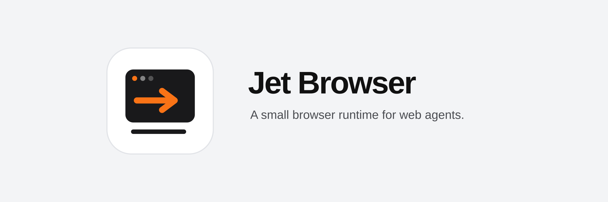
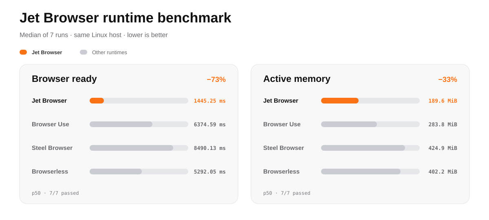

  

<a href="./README.md">English</a> · <a href="./README.zh-CN.md">简体中文</a> · <a href="./README.ja.md">日本語</a> · <a href="./README.ko.md">한국어</a> · <a href="./README.de.md">Deutsch</a> · Français · <a href="./README.es.md">Español</a> · <a href="./README.pt-BR.md">Português</a>

Jet Browser réunit un vrai navigateur WPE WebKit et un pont WebDriver en Rust dans un moteur autonome pour agents. Chaque conteneur exécute une session isolée, reçoit des commandes JSON ordonnées sur l’entrée standard et renvoie des résultats lisibles par machine sur la sortie standard.

Aucun compte, aucune clé API, aucune base de données ni aucun plan de contrôle hébergé ne sont requis.

## Démarrage rapide

Docker suffit pour vérifier le moteur : aucun clonage, Node.js, compte, clé API ou accès réseau sortant du navigateur n’est nécessaire :

~~~bash
curl -fsSL https://raw.githubusercontent.com/masakaai/jet-browser/main/scripts/try-jet.sh | sh
~~~

Le [script vérifiable](./scripts/try-jet.sh) télécharge la politique seccomp liée à la version, vérifie son SHA-256, sélectionne nativement `linux/amd64` ou `linux/arm64` depuis l’image multiplateforme immuable et teste le démarrage, la saisie native, l’état du DOM et la capture PNG. Il utilise un conteneur jetable, limité en ressources et sans réseau, sans monter le socket Docker ni un répertoire hôte.

## Benchmark reproductible du runtime

Jet Browser a atteint une page vérifiée en **1 445,25 ms** avec **189,6 MiB** de mémoire active—**72,7 % de temps de préparation en moins** et **33,2 % de mémoire en moins** que le résultat suivant. [Méthode](./docs/benchmarks.md) · [Données](./benchmarks/results/runtime-2026-10-07.json)

## Cœur open source

- WPE WebKit 2.54 et compositeur Wayland headless
- pont d’automatisation JSONL ordonné écrit en Rust
- pointeur, clavier, texte, tactile, molette, glisser, navigation et onglets
- titre, URL, évaluation JavaScript, captures et DOM sémantique
- import/export des cookies et du Web Storage via des chemins de profil explicites
- composants facultatifs Visual frame, Live DOM, prise de contrôle humaine et Worker distribué

Le chemin essentiel est Agent → JSONL → jet-wpe → WebDriver → WPE WebKit. Le mode autonome n’installe ni serveur applicatif, ni client de base de données, ni tunnel, ni SDK de paiement, ni framework d’agent imposé.

Voir [Architecture](./docs/architecture.md) et [Démo autonome](./docs/demo.md).

## Développement et vérification

~~~bash
npm ci
npm test
cargo test --all-targets
docker build -f Dockerfile.standalone -t jet-browser:local .
~~~

Jet Browser est une infrastructure de navigateur, pas un LLM ni un framework d’agent. Distribué sous [Apache License 2.0](./LICENSE).
